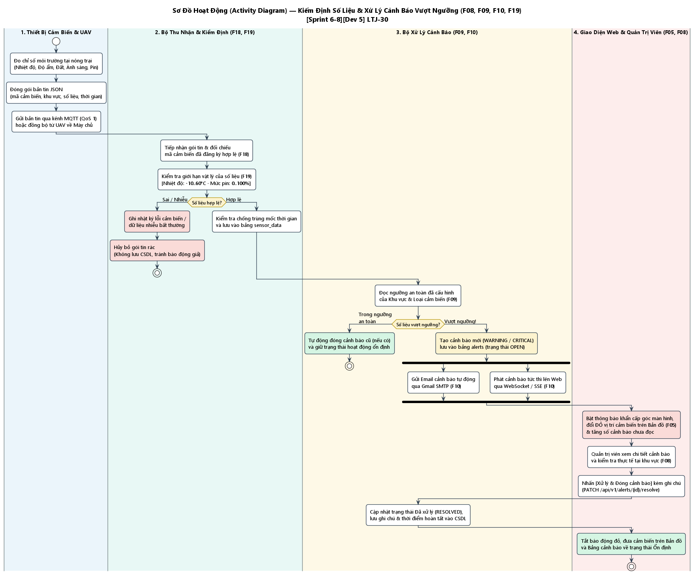

# Đặc Tả Sơ Đồ Hoạt Động (Activity Diagram) — Kiểm Định Số Liệu & Cảnh Báo Vượt Ngưỡng

**Dự án:** Nền tảng IoT có UAV hỗ trợ phục vụ giám sát và thu thập dữ liệu cảm biến nông trại  
**Mã công việc:** `[Sprint 6–8][Dev 5] LTJ-30`  
**Chuẩn mô hình hóa:** UML 2.0 (Swimlane Activity Diagram)  

- **Mã nguồn PlantUML:** [`docs/Activity_Diagram_Alert.puml`](./Activity_Diagram_Alert.puml)
- **Hình ảnh kết xuất:** [`docs/images/Activity_Diagram_Alert.png`](./images/Activity_Diagram_Alert.png) · [`Activity_Diagram_Alert.svg`](./images/Activity_Diagram_Alert.svg)

---

## 1. Bốn Phân Vùng Trách Nhiệm (Swimlanes)

| Phân vùng (Swimlane) | Thành phần thực thi trong mã nguồn | Trách nhiệm chính |
|---|---|---|
| **1. Thiết Bị Cảm Biến & UAV** | Module `iot-simulator` (`MqttPublisher`, `UavFlightSimulator`) | Đo thông số môi trường, đóng gói JSON và truyền qua MQTT (QoS 1) hoặc đồng bộ từ UAV. |
| **2. Bộ Thu Nhận & Kiểm Định (`F18, F19`)** | `MqttGatewayConfig`, `SensorDataServiceImpl`, `SensorDataValidator` | Đối chiếu cảm biến đã đăng ký (`F18`), lọc bỏ dữ liệu nhiễu ngoài dải vật lý (`F19`), chống trùng lặp và lưu vào `sensor_data`. |
| **3. Bộ Xử Lý Cảnh Báo (`F09, F10`)** | `AlertEngineWorker`, `EmailAlertService`, `TelemetryRealtimeService`, `AlertServiceImpl` | Đối chiếu số liệu với ngưỡng cấu hình (`F09`), tạo cảnh báo `WARNING/CRITICAL`, kích hoạt song song gửi Email SMTP và đẩy WebSocket/SSE (`F10`), lưu kết quả đóng cảnh báo. |
| **4. Giao Diện Web & Quản Trị Viên (`F05, F08`)** | Ứng dụng React 19 SPA (Bản đồ Leaflet, Bảng Quản lý Cảnh báo) | Hiển thị cảnh báo đỏ tức thì trên màn hình & bản đồ (`F05`), hỗ trợ quản trị viên kiểm tra và đóng cảnh báo kèm ghi chú (`PATCH /api/v1/alerts/{id}/resolve` — `F08`). |

---

## 2. Giải Thích Luồng Nghiệp Vụ Từng Bước

1. **Thu thập tại nông trại:** Cảm biến đo nhiệt độ, độ ẩm không khí, độ ẩm đất, ánh sáng, mức pin → đóng gói JSON gửi qua MQTT (QoS 1) hoặc qua UAV Mobile Gateway.
2. **Chốt chặn kiểm định vật lý (`F18, F19`):**
   - **Nhánh `Sai / Nhiễu`:** Nếu thông số vượt ngoài giới hạn vật lý hợp lý (ví dụ nhiệt độ `< -10°C` hoặc `> 60°C`, pin `< 0%` hoặc `> 100%`), hệ thống ghi nhật ký lỗi và **hủy gói tin ngay lập tức (`stop`)**, không lưu CSDL và không gây báo động giả.
   - **Nhánh `Hợp lệ`:** Kiểm tra chống ghi trùng mốc thời gian và lưu vào bảng `sensor_data`.
3. **Đánh giá ngưỡng cảnh báo (`F09, F10`):**
   - **Nhánh `Trong ngưỡng an toàn`:** Hệ thống tự động đóng cảnh báo cũ (nếu trước đó đang mở) và kết thúc phiên kiểm tra (`stop`).
   - **Nhánh `Vượt ngưỡng!`:** Khởi tạo bản ghi `Alert` mới (`OPEN`, mức `WARNING` hoặc `CRITICAL`), sau đó thực thi **đồng thời (`fork`)** hai tác vụ thông báo (`F10`):
     - Gửi thư điện tử cảnh báo qua **Gmail SMTP** (`EmailAlertService`).
     - Phát sự kiện trực tiếp qua **WebSocket / SSE** (`TelemetryRealtimeService`).
4. **Phản hồi & Xử lý của Quản trị viên (`F05, F08`):**
   - Giao diện Web bật thông báo khẩn cấp, đổi màu đỏ vị trí cảm biến trên Bản đồ (`F05`) và tăng bộ đếm chưa đọc.
   - Quản trị viên kiểm tra thực tế tại khu vực, nhấn **Xử lý & Đóng cảnh báo** kèm ghi chú (`PATCH /api/v1/alerts/{id}/resolve`) → Backend cập nhật `status = RESOLVED` → Giao diện trở về trạng thái ổn định (`stop`).

---

## 3. Sơ Đồ Hoạt Động

