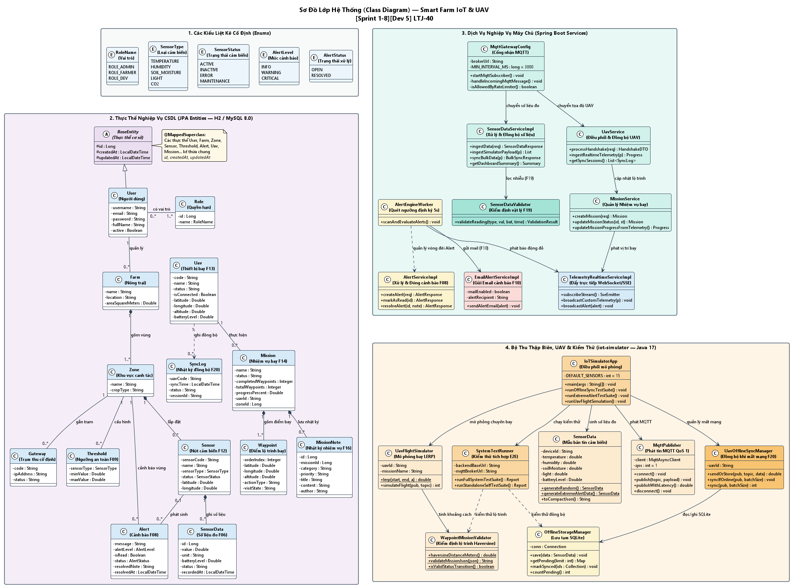

# Đặc Tả Sơ Đồ Lớp Hệ Thống (Class Diagram Specification) — Smart Farm IoT & UAV

**Dự án:** Nền tảng IoT có UAV hỗ trợ phục vụ giám sát và thu thập dữ liệu cảm biến nông trại  
**Mã công việc:** `[Sprint 1–8][Dev 5] LTJ-40`  
**Chuẩn mô hình hóa:** UML 2.0  

- **Mã nguồn PlantUML:** [`docs/Class_Diagram.puml`](./Class_Diagram.puml)
- **Hình ảnh kết xuất:** [`docs/images/Class_Diagram.png`](./images/Class_Diagram.png) · [`Class_Diagram.svg`](./images/Class_Diagram.svg)

---

## 1. Cấu Trúc 4 Phân Nhóm Lớp (Packages 1 → 4)

### Nhóm 1: Các Kiểu Liệt Kê Cố Định (`Enums`)
- **`RoleName`:** Phân quyền người dùng (`ROLE_ADMIN`, `ROLE_FARMER`, `ROLE_DEV`).
- **`SensorType`:** Các loại chỉ số cảm biến (`TEMPERATURE`, `HUMIDITY`, `SOIL_MOISTURE`, `LIGHT`, `CO2`).
- **`SensorStatus`:** Trạng thái hoạt động nút cảm biến (`ACTIVE`, `INACTIVE`, `ERROR`, `MAINTENANCE`).
- **`AlertLevel` & `AlertStatus`:** Mức độ nghiêm trọng (`INFO`, `WARNING`, `CRITICAL`) và trạng thái xử lý cảnh báo (`OPEN`, `RESOLVED`).

### Nhóm 2: Thực Thể Nghiệp Vụ CSDL (`JPA Entities — H2 / MySQL 8.0`)
- **`BaseEntity` (`@MappedSuperclass`):** Lớp trừu tượng cung cấp `id`, `createdAt`, `updatedAt`.
- **Chuỗi Nông trại & Cảm biến:** `User` (`1 — 0..*`) `Farm` (`1 *-- 1..*`) `Zone` (`1 *-- 0..*`) `Sensor` (`1 *-- 0..*`) `SensorData`, kết hợp với `Role`, `Gateway`, `Threshold` (`F09`) và `Alert` (`F08`).
- **Chuỗi Thiết bị bay & Nhiệm vụ UAV:** `Uav` (`1 — 0..*`) `Mission` (`1 *-- 1..*` `Waypoint` và `1 *-- 0..*` `MissionNote` — `F14, F16`), cùng `SyncLog` lưu lịch sử các phiên đồng bộ dữ liệu ngoại tuyến (`F20`).

### Nhóm 3: Dịch Vụ Nghiệp Vụ Máy Chủ (`Spring Boot Services`)
- **Thu nhận & Kiểm định (`F18–F20`):** `MqttGatewayConfig` nhận gói tin MQTT kèm chống gửi dồn dập (`>= 3000ms`), chuyển cho `SensorDataServiceImpl` và `SensorDataValidator` kiểm tra dải vật lý.
- **Điều phối UAV & Lộ trình (`F13–F17`):** `UavService` và `MissionService` xử lý bắt tay đồng bộ (`Handshake`), cập nhật tiến độ bay và đẩy vị trí trực tiếp.
- **Cảnh báo & Thông báo (`F08–F10`):** `AlertEngineWorker` (`scanAndEvaluateAlerts()` mỗi 5 giây) phát hiện vượt ngưỡng, kích hoạt `EmailAlertServiceImpl` (Gmail SMTP) và `TelemetryRealtimeServiceImpl` (WebSocket/SSE), phối hợp `AlertServiceImpl` đóng cảnh báo.

### Nhóm 4: Bộ Thu Thập Biên, UAV & Kiểm Thử (`iot-simulator — Java 17`)
- **`IoTSimulatorApp` & `SystemTestRunner`:** Điều phối các kịch bản mô phỏng cảm biến, bay UAV và kiểm thử tích hợp toàn trình (E2E).
- **`SensorData` & `MqttPublisher`:** Sinh bản tin cảm biến (bình thường/nhiễu/vượt ngưỡng) và truyền qua MQTT `QoS 1`.
- **`UavOfflineSyncManager` & `OfflineStorageManager` (`F20`):** Tự động lưu bản tin vào SQLite (`iot_offline.db`) khi rớt mạng và đồng bộ hàng loạt khi có mạng trở lại.
- **`UavFlightSimulator` & `WaypointMissionValidator` (`F14, F15`):** Nội suy đường bay tuyến tính (`LERP`) và kiểm định khoảng cách địa lý Haversine.

---

## 2. Sơ Đồ Lớp Hệ Thống

