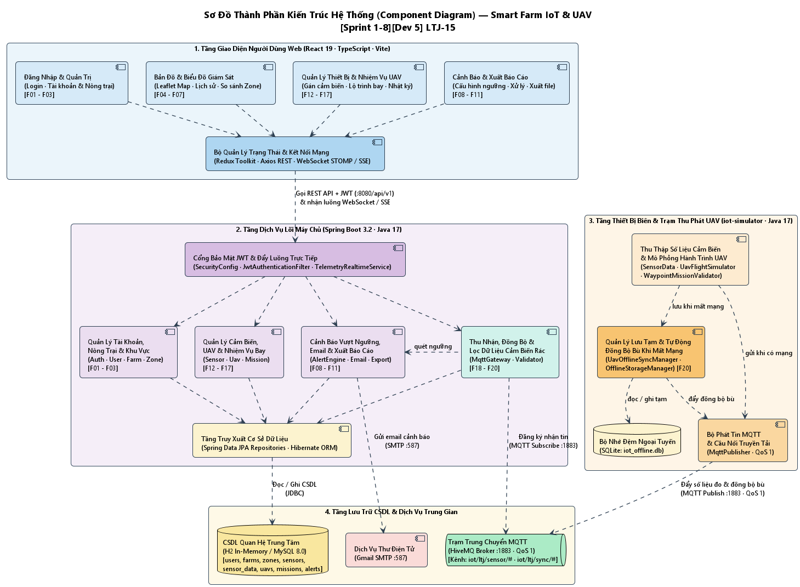

# Đặc Tả Sơ Đồ Thành Phần Kiến Trúc (Component Diagram) — Smart Farm IoT & UAV

**Dự án:** Nền tảng IoT có UAV hỗ trợ phục vụ giám sát và thu thập dữ liệu cảm biến nông trại  
**Mã công việc:** `[Sprint 1–8][Dev 5] LTJ-15`  
**Chuẩn mô hình hóa:** UML 2.0  

- **Mã nguồn PlantUML:** [`docs/Component_Diagram.puml`](./Component_Diagram.puml)
- **Hình ảnh kết xuất:** [`docs/images/Component_Diagram.png`](./images/Component_Diagram.png) · [`Component_Diagram.svg`](./images/Component_Diagram.svg)

---

## 1. Kiến Trúc 4 Phân Tầng Của Hệ Thống

### Tầng 1: Giao Diện Người Dùng Web (`React 19 · TypeScript · Vite`)
- **Đăng Nhập & Quản Trị (`F01–F03`):** Quản lý xác thực người dùng, tài khoản, phân quyền, nông trại và phân khu (Zone).
- **Bản Đồ & Biểu Đồ Giám Sát (`F04–F07`):** Dashboard tổng quan, bản đồ vị trí cảm biến (Leaflet), biểu đồ lịch sử và so sánh giữa các Zone.
- **Quản Lý Thiết Bị & Nhiệm Vụ UAV (`F12–F17`):** Gán cảm biến, quản lý UAV/Gateway, thiết lập lộ trình bay Waypoints, giám sát telemetry và xem lại kết quả.
- **Cảnh Báo & Xuất Báo Cáo (`F08–F11`):** Cấu hình ngưỡng an toàn, nhận cảnh báo trực tiếp, đóng cảnh báo và kết xuất báo cáo tổng hợp.
- **Bộ Quản Lý Trạng Thái & Kết Nối Mạng:** Tập trung trạng thái qua Redux Toolkit, gọi REST API kèm JWT qua Axios và nhận luồng trực tiếp qua WebSocket STOMP / SSE.

### Tầng 2: Dịch Vụ Lõi Máy Chủ (`Spring Boot 3.2 · Java 17`)
- **Cổng Bảo Mật JWT & Đẩy Luồng Trực Tiếp:** Bộ lọc xác thực `JwtAuthenticationFilter`, `SecurityConfig`, `JwtTokenProvider` và bộ phát sự kiện trực tiếp `TelemetryRealtimeService`.
- **4 Phân hệ Nghiệp vụ cốt lõi:**
  1. `Quản Lý Tài Khoản, Nông Trại & Khu Vực (F01–F03)`
  2. `Quản Lý Cảm Biến, UAV & Nhiệm Vụ Bay (F12–F17)`
  3. `Cảnh Báo Vượt Ngưỡng, Email & Xuất Báo Cáo (F08–F11)`
  4. `Thu Nhận, Đồng Bộ & Lọc Dữ Liệu Cảm Biến Rác (F18–F20)`
- **Tầng Truy Xuất CSDL:** Hệ thống `Spring Data JPA Repositories` ánh xạ ORM qua Hibernate.

### Tầng 3: Thiết Bị Biên & Trạm Thu Phát UAV (`iot-simulator · Java 17`)
- **Thu Thập Số Liệu & Mô Phỏng Hành Trình UAV:** Sinh chỉ số đa cảm biến (`SensorData`), nội suy đường bay LERP (`UavFlightSimulator`) và kiểm tra khoảng cách Haversine (`WaypointMissionValidator`).
- **Quản Lý Lưu Tạm & Tự Động Đồng Bộ Bù (`F20`):** Khi mất mạng, `UavOfflineSyncManager` và `OfflineStorageManager` ghi dữ liệu vào **Bộ nhớ đệm SQLite (`iot_offline.db`)**; khi có mạng trở lại sẽ tự động đẩy gói đồng bộ hàng loạt (`Bulk Sync`).
- **Bộ Phát Tin MQTT (`MqttPublisher`):** Truyền tải gói tin JSON với chất lượng dịch vụ `QoS 1`.

### Tầng 4: Lưu Trữ CSDL & Dịch Vụ Trung Gian
- **CSDL Quan Hệ Trung Tâm:** `H2 In-Memory` (chạy trình diễn) và `MySQL 8.0` (triển khai thực tế).
- **Dịch Vụ Thư Điện Tử (`Gmail SMTP :587`):** Gửi thông báo cảnh báo tự động qua email (`F10`).
- **Trạm Trung Chuyển MQTT (`HiveMQ Broker :1883`):** Cầu nối thông điệp bất đồng bộ giữa thiết bị biên/UAV và máy chủ trung tâm.

---

## 2. Sơ Đồ Thành Phần

