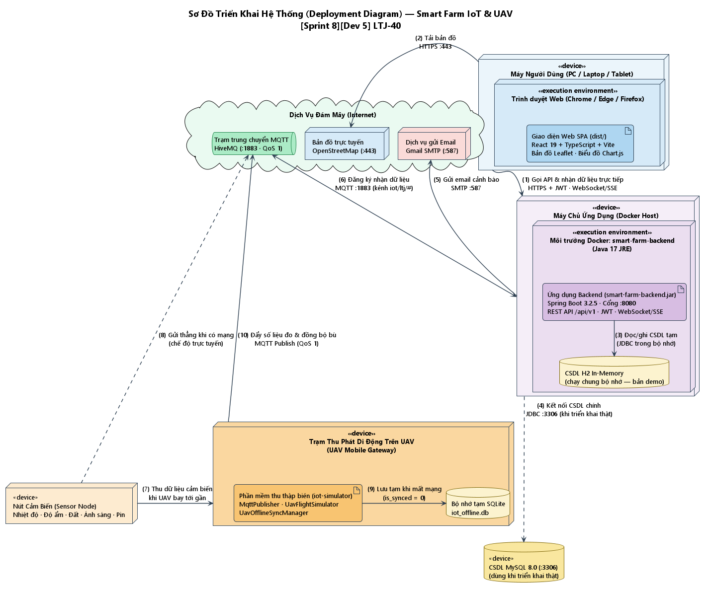

# Đặc Tả Sơ Đồ Triển Khai Hệ Thống (Deployment Diagram) — Smart Farm IoT & UAV

**Dự án:** Nền tảng IoT có UAV hỗ trợ phục vụ giám sát và thu thập dữ liệu cảm biến nông trại  
**Mã công việc:** `[Sprint 8][Dev 5] LTJ-40`  
**Chuẩn mô hình hóa:** UML 2.0  

- **Mã nguồn PlantUML:** [`docs/Deployment_Diagram.puml`](./Deployment_Diagram.puml)
- **Hình ảnh kết xuất:** [`docs/images/Deployment_Diagram.png`](./images/Deployment_Diagram.png) · [`Deployment_Diagram.svg`](./images/Deployment_Diagram.svg)

---

## 1. Các Nút Vật Lý & Môi Trường Thực Thi (Nodes & Execution Environments)

| Phân tầng | Nút triển khai | Ký hiệu UML | Thành phần bên trong (Artifacts) |
|---|---|---|---|
| **Tầng Người Dùng** | Máy Người Dùng (PC / Laptop / Tablet) | `<<device>>` + `<<execution environment>>` Trình duyệt Web | Bản đóng gói tĩnh `Web SPA (dist/)` xây dựng bằng React 19, TypeScript, Vite, Leaflet Map, Chart.js. |
| **Tầng Đám Mây** | Dịch Vụ Đám Mây (Internet) | `cloud` | `Trạm trung chuyển MQTT HiveMQ (:1883)`, `Bản đồ trực tuyến OpenStreetMap (:443)`, `Dịch vụ gửi Email Gmail SMTP (:587)`. |
| **Tầng Máy Chủ** | Máy Chủ Ứng Dụng (Docker Host) | `<<device>>` + `<<execution environment>>` Docker Container | Gói thực thi `smart-farm-backend.jar` (Spring Boot 3.2.5, Java 17, cổng `:8080`), CSDL tạm `H2 In-Memory` (bản demo) và kết nối sang `CSDL MySQL 8.0 (:3306)` khi triển khai thật. |
| **Tầng Biên Nông Trại** | Nút Cảm Biến & Trạm Thu Phát Di Động Trên UAV | `<<device>>` | Module `iot-simulator` (Java 17: `MqttPublisher`, `UavFlightSimulator`, `UavOfflineSyncManager`) và bộ nhớ tạm ngoại tuyến `SQLite (iot_offline.db)`. |

---

## 2. Giải Thích Luồng Kết Nối Từ (1) Đến (10)

1. **`(1)` Gọi API & nhận dữ liệu trực tiếp:** Trình duyệt gọi REST API bảo mật JWT tới Backend (`:8080/api/v1`) và nhận luồng cập nhật trực tiếp qua WebSocket STOMP / SSE.
2. **`(2)` Tải bản đồ:** Trình duyệt tải lớp nền bản đồ địa lý từ máy chủ OpenStreetMap qua `HTTPS :443`.
3. **`(3)` Đọc/ghi CSDL tạm:** Ứng dụng Backend truy xuất nhanh dữ liệu trên `H2 In-Memory` trong cùng tiến trình JVM khi chạy bản trình diễn (demo).
4. **`(4)` Kết nối CSDL chính:** Khi triển khai thực tế, Backend kết nối sang máy chủ `MySQL 8.0` qua `JDBC :3306`.
5. **`(5)` Gửi email cảnh báo:** Khi thông số vượt ngưỡng hoặc sự cố nhiệm vụ UAV, Backend gửi thông báo qua `Gmail SMTP (:587)` (`F10`).
6. **`(6)` Đăng ký nhận dữ liệu:** Backend duy trì kết nối `MQTT :1883` lắng nghe toàn bộ nhánh kênh `iot/ltj/#` (QoS 1).
7. **`(7)` Thu dữ liệu cảm biến khi UAV bay tới gần:** Nút cảm biến truyền các chỉ số đo được sang trạm thu phát gắn trên UAV khi UAV bay qua vùng phủ sóng.
8. **`(8)` Gửi thẳng khi có mạng:** Ở khu vực có sẵn kết nối mạng ổn định, nút cảm biến có thể gửi trực tiếp bản tin lên trạm HiveMQ.
9. **`(9)` Lưu tạm khi mất mạng:** Khi bay vào vùng lõm sóng mất Internet, `UavOfflineSyncManager` ghi dữ liệu vào tệp `SQLite (iot_offline.db)` với cờ `is_synced = 0` (`F20`).
10. **`(10)` Đẩy số liệu đo & đồng bộ bù:** Ngay khi kết nối mạng khôi phục, UAV đẩy telemetry hành trình và gói đồng bộ hàng loạt (`Bulk Sync`, QoS 1) lên trạm HiveMQ về máy chủ trung tâm (`F20`).

---

## 3. Sơ Đồ Triển Khai

