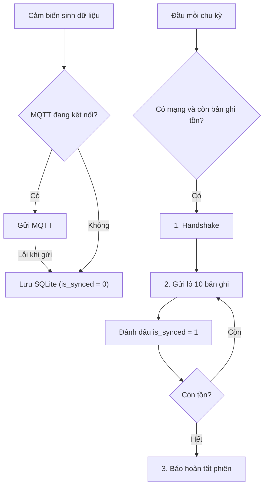

# 📡 Báo Cáo Kiểm Thử UAV Offline Sync - Sprint 5 (LTJ-25)

> **Task Jira**: `[LTJ-25]` `[Sprint 5][Dev 5] Giả lập UAV Offline Sync (SQLite Local to MQTT)`  
> **Người thực hiện**: Dev 5 — Mô-đun `iot-simulator`  
> **Liên quan**: Dev 1 (`LTJ-21` - Bulk Insert & chống trùng), Dev 2 (`LTJ-22` - Handshake & Log Sync)

---

## 1. Mục Tiêu

| Yêu cầu Jira | Cách đáp ứng |
|---|---|
| Ghi data vào file SQLite local khi mất mạng | `UavOfflineSyncManager.sendOrStore()` → `OfflineStorageManager.save()` |
| Có mạng lại thì script **tự** đọc SQLite và đẩy Bulk lên MQTT | `UavOfflineSyncManager.syncIfOnline()` được gọi ở **mỗi chu kỳ** của chế độ chạy liên tục |

---

## 2. Thiết Kế

### 2.1. Bảng SQLite (`iot_offline.db`)

| Cột | Kiểu | Ý nghĩa |
|---|---|---|
| `id` | `INTEGER` (tự tăng) | Thứ tự ghi nhận |
| `payload` | `TEXT` | JSON của `SensorData` (giống hệt gói gửi online) |
| `is_synced` | `INTEGER` | `0` = chưa gửi, `1` = đã gửi thành công |

### 2.2. Luồng xử lý



### 2.3. MQTT Topic

| Bước | Topic | Bên nhận |
|---|---|---|
| 1. Handshake | `iot/ltj/sync/handshake/request` | Dev 2 (LTJ-22) |
| 2. Dữ liệu theo lô | `iot/ltj/sync/bulk` | Dev 1 (LTJ-21) |
| 3. Hoàn tất phiên | `iot/ltj/sync/handshake/complete` | Dev 2 (LTJ-22) |

**Gói Bulk mẫu:**
```json
{
  "syncSessionId": "SYNC-UAV-ALPHA-01-1793705190",
  "uavId": "UAV-ALPHA-01",
  "totalRecords": 10,
  "records": [
    { "deviceId": "DEV-Z1-001", "farmId": 1, "zoneId": 1, "temperature": 27.4, "humidity": 68.5,
      "soilMoisture": 62.0, "light": 520.0, "status": "NORMAL", "timestamp": 1793705100 }
  ]
}
```

### 2.4. Đảm bảo không mất dữ liệu
- Chỉ đánh dấu `is_synced = 1` **sau khi** publish QoS 1 nhận được PUBACK.
- Rớt mạng giữa lúc đồng bộ → phần chưa gửi vẫn là `0`, tự gửi lại ở chu kỳ sau.
- Gửi lại có thể làm trùng 1 lô → Backend (Dev 1) chống trùng theo cặp `deviceId + timestamp`.

---

## 3. Kết Quả Kiểm Thử

### 3.1. Unit Test (JUnit 5) — **7/7 PASS**

| # | Test | Kịch bản | Kết quả |
|---|---|---|---|
| 1 | `luuDuLieuKhiMatMang` | Lưu 25 bản ghi → pending = 25 | ✅ |
| 2 | `layTheoLoVaDanhDauDaGui` | Lấy lô 10, đánh dấu → pending 15 / synced 10 | ✅ |
| 3 | `guiHetThiKhongConTonDong` | Lặp đến hết → pending 0 / synced 25 | ✅ |
| 4 | `coMangThiGuiThangKhongLuuSQLite` | Có mạng → gửi thẳng, SQLite trống | ✅ |
| 5 | `matMangThiTuLuuVaoSQLite` | Mất mạng → 25 bản ghi vào SQLite, 0 gói gửi đi | ✅ |
| 6 | `coMangLaiThiTuDongBoDungThuTu` | Có mạng lại → Handshake, 3 lô (10+10+5), Hoàn tất | ✅ |
| 7 | `rotMangGiuaChungKhongMatDuLieu` | Rớt mạng sau lô 1 → còn 15; có mạng lại → gửi nốt, 25/25 | ✅ |

> Test 4–7 dùng `FakePublisher` (MQTT giả lập bật/tắt được) để kiểm chứng rớt mạng giữa chừng mà không cần rút mạng thật.

### 3.2. Chạy thực tế với HiveMQ Broker

**Giai đoạn 1 – Mất mạng** (trỏ tới broker không tồn tại `tcp://127.0.0.1:1`, 6 sensors, 5 chu kỳ):
```text
!! Khong ket noi duoc MQTT Broker -> Chay che do OFFLINE, luu du lieu vao SQLite.
[#0030][OFFLINE -> SQLite] [Farm: 1 | Zone: 3 | Device: DEV-Z3-002] Temp: 33,1°C ...
  [Chu ky 05] OFFLINE (dang luu SQLite) - 6 sensors trong 85 ms
```
→ 30 bản ghi được lưu vào `iot_offline.db`.

**Giai đoạn 2 – Có mạng lại** (`tcp://broker.hivemq.com:1883`):
```text
>> Connected successfully!
>> Co mang tro lai -> tu dong dong bo du lieu offline:
  [1] Handshake: 30 ban ghi cho dong bo, session = SYNC-UAV-ALPHA-01-1793705190
  [2] Da gui lo 10 ban ghi (10/30)
  [2] Da gui lo 10 ban ghi (20/30)
  [2] Da gui lo 10 ban ghi (30/30)
  [3] Hoan tat phien dong bo.
  [Chu ky 01] ONLINE - 6 sensors trong 1890 ms
  [Chu ky 02] ONLINE - 6 sensors trong 558 ms
```
→ **30/30 bản ghi tồn được tự động đồng bộ (100%)**, sau đó tiếp tục gửi online bình thường.

---

## 4. Hướng Dẫn Demo

```powershell
cd iot-simulator

# Cách 1: Demo thật - chạy liên tục, tắt WiFi để thấy OFFLINE -> SQLite, bật lại để thấy tự đồng bộ
.\gradlew.bat run

# Cách 2: Demo nhanh theo kịch bản (lưu 30 bản ghi -> kết nối -> đồng bộ lô 10)
.\gradlew.bat run --args="--test-offline-sync 30 10" --console=plain

# Chạy unit test
.\gradlew.bat test
```

---

## 5. Giới Hạn & Phối Hợp Tiếp Theo

| Nội dung | Trạng thái |
|---|---|
| UAV chờ phản hồi `SYNC_ACCEPT` từ Backend trước khi gửi dữ liệu | ⏳ Chờ Dev 2 (LTJ-22) chốt format. Hiện UAV gửi Handshake rồi gửi dữ liệu ngay |
| Backend nhận `iot/ltj/sync/bulk`, insert hàng loạt, chống trùng | ⏳ Dev 1 (LTJ-21) |
| Kiểm thử tích hợp end-to-end với Backend | ⏳ Khi LTJ-21, LTJ-22 hoàn thành |
