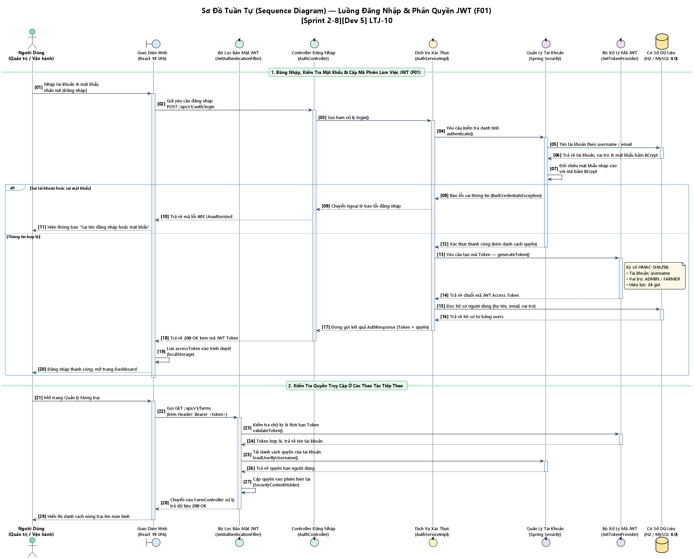
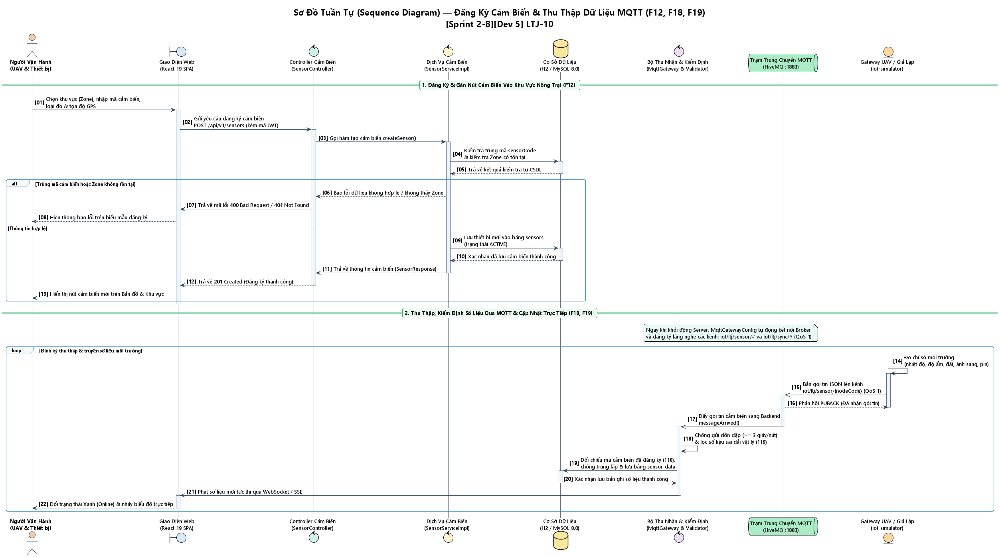

# Đặc Tả Sơ Đồ Tuần Tự (Sequence Diagram Specification) — Smart Farm IoT & UAV

**Dự án:** Nền tảng IoT có UAV hỗ trợ phục vụ giám sát và thu thập dữ liệu cảm biến nông trại  
**Mã công việc:** `[Sprint 2–8][Dev 5] LTJ-10`  
**Chuẩn mô hình hóa:** UML 2.0  

- **Mã nguồn PlantUML:**
  - [`docs/Sequence_Auth_Login.puml`](./Sequence_Auth_Login.puml)
  - [`docs/Sequence_Add_Device.puml`](./Sequence_Add_Device.puml)
- **Hình ảnh kết xuất:**
  - [`docs/images/Sequence_Auth_Login.png`](./images/Sequence_Auth_Login.png) · [`Sequence_Auth_Login.svg`](./images/Sequence_Auth_Login.svg)
  - [`docs/images/Sequence_Add_Device.png`](./images/Sequence_Add_Device.png) · [`Sequence_Add_Device.svg`](./images/Sequence_Add_Device.svg)

---

## 1. Sơ Đồ 1: Luồng Đăng Nhập & Xác Thực Phân Quyền JWT (`F01`)

### 1.1. Các thành phần tham gia (Lifelines)
| Thành phần | Ký hiệu UML | Lớp / Công nghệ thực tế trong hệ thống |
|---|---|---|
| **Người Dùng** | `actor` | `Farm Administrator` hoặc `UAV & Device Operator` |
| **Web SPA** | `boundary` | Ứng dụng React 19 + TypeScript + Vite |
| **JwtAuthenticationFilter** | `control` | `com.smartfarm.backend.security.JwtAuthenticationFilter` |
| **AuthController** | `control` | `com.smartfarm.backend.controller.AuthController` |
| **AuthServiceImpl** | `control` | `com.smartfarm.backend.service.impl.AuthServiceImpl` |
| **AuthenticationManager & CustomUserDetailsService** | `control` | Spring Security + `CustomUserDetailsService` |
| **JwtTokenProvider** | `control` | `com.smartfarm.backend.security.JwtTokenProvider` |
| **CSDL Quan Hệ** | `database` | H2 In-Memory (demo) / MySQL 8.0 (production) — bảng `users`, `roles` |

### 1.2. Trình tự xử lý chính
1. **Gửi yêu cầu đăng nhập:** Client gọi `POST /api/v1/auth/login` với `LoginRequest { usernameOrEmail, password }`.
2. **Kiểm tra mật khẩu BCrypt:** `AuthenticationManager` nạp tài khoản qua `CustomUserDetailsService` và đối chiếu `PasswordEncoder.matches()`.
3. **Rẽ nhánh `alt`:**
   - **Nhánh lỗi:** Ném `BadCredentialsException`, trả `401 Unauthorized`.
   - **Nhánh hợp lệ:** `JwtTokenProvider.generateToken()` ký chuỗi JWT bằng `HMAC-SHA256` (chứa `username`, danh sách `roles`, thời hạn 24h), trả `200 OK ApiResponse<AuthResponse>`. Client lưu `accessToken` vào `localStorage`.
4. **Ủy quyền các request tiếp theo:** Khi gọi API bảo mật (ví dụ `GET /api/v1/farms`), `JwtAuthenticationFilter` kiểm tra chữ ký Bearer Token, nạp quyền vào `SecurityContextHolder` trước khi chuyển vào Controller.

---

## 2. Sơ Đồ 2: Luồng Đăng Ký Cảm Biến & Thu Thập Telemetry Qua MQTT (`F12`, `F18`, `F19`)

### 2.1. Các thành phần tham gia (Lifelines)
| Thành phần | Ký hiệu UML | Lớp / Công nghệ thực tế trong hệ thống |
|---|---|---|
| **UAV & Device Operator** | `actor` | Người vận hành thiết bị và nhiệm vụ bay UAV |
| **Web SPA** | `boundary` | Giao diện quản lý cảm biến & bản đồ số (React 19) |
| **SensorController** | `control` | `com.smartfarm.backend.controller.SensorController` |
| **SensorServiceImpl** | `control` | `com.smartfarm.backend.service.impl.SensorServiceImpl` |
| **CSDL Quan Hệ** | `database` | H2 In-Memory / MySQL 8.0 — bảng `zones`, `sensors`, `sensor_data` |
| **MqttGatewayConfig & SensorDataServiceImpl** | `control` | `MqttGatewayConfig`, `SensorDataServiceImpl`, `SensorDataValidator` |
| **HiveMQ MQTT Broker** | `queue` | MQTT Broker cổng `:1883` (QoS 1) |
| **UAV Mobile Gateway / IoT Simulator** | `entity` | Module `iot-simulator` (Java 17 `MqttPublisher`) |

### 2.2. Trình tự xử lý chính
1. **Đăng ký cảm biến (`F12`):** Người vận hành gửi `POST /api/v1/sensors` kèm `SensorCreateRequest { sensorCode, sensorType, zoneId, latitude, longitude }`.
2. **Kiểm tra ràng buộc (`alt`):** `SensorServiceImpl` kiểm tra trùng mã `sensorCode` và sự tồn tại của `Zone`. Nếu hợp lệ, lưu bản ghi vào bảng `sensors` (`status = ACTIVE`) và trả về `201 Created`.
3. **Thu thập & Kiểm định Telemetry qua MQTT (`F18`, `F19` — khung `loop`):**
   - Khi khởi động (`@PostConstruct`), `MqttGatewayConfig` đăng ký lắng nghe `iot/ltj/sensor/#` và `iot/ltj/sync/#` (QoS 1).
   - Thiết bị biên / UAV Gateway gửi bản tin JSON (`IoTSimulatorPayload`) lên topic `iot/ltj/sensor/{nodeCode}`.
   - Backend kiểm tra giới hạn tần suất (`Rate-Limit >= 3000ms/node`), xác thực mã cảm biến đã đăng ký (`F18`), kiểm định dải giá trị vật lý qua `SensorDataValidator` & chống trùng mốc thời gian (`F19`), lưu vào bảng `sensor_data` và phát sự kiện WebSocket / SSE cập nhật giao diện thời gian thực.
