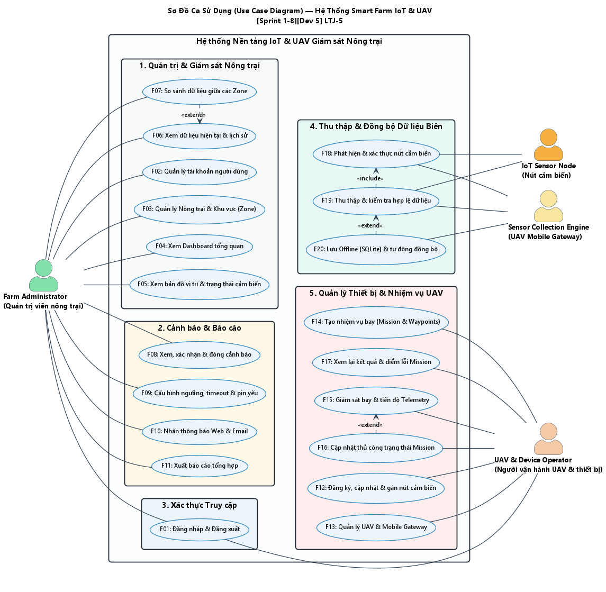

# Đặc Tả Sơ Đồ Ca Sử Dụng (Use Case Diagram) — Smart Farm IoT & UAV

**Dự án:** Nền tảng IoT có UAV hỗ trợ phục vụ giám sát và thu thập dữ liệu cảm biến nông trại  
**Mã công việc:** `[Sprint 1–8][Dev 5] LTJ-5`  
**Chuẩn mô hình hóa:** UML 2.0  

---

## 1. Danh sách Tác nhân (Actors)

| # | Tác nhân (Actor) | Phân loại | Vai trò trong hệ thống |
|---|---|---|---|
| 1 | **Farm Administrator** *(Quản trị viên nông trại)* | Tác nhân chính (Con người) | Quản lý tài khoản, nông trại, khu vực (Zone), giám sát bản đồ/dashboard, cấu hình ngưỡng, xử lý cảnh báo và xuất báo cáo (`F01–F11`). |
| 2 | **UAV & Device Operator** *(Người vận hành UAV & thiết bị)* | Tác nhân chính (Con người) | Đăng ký/gán nút cảm biến, quản lý UAV & Mobile Gateway, lập kế hoạch bay (Mission & Waypoints), theo dõi telemetry và kết quả thu thập (`F01`, `F12–F17`). |
| 3 | **Sensor Collection Engine** *(UAV Mobile Gateway)* | Tác nhân hệ thống / Thiết bị biên | Phát hiện, xác thực nút cảm biến đã đăng ký, kiểm tra tính hợp lệ dữ liệu, lưu đệm SQLite khi mất mạng và tự động đồng bộ lên máy chủ (`F18–F20`). |
| 4 | **IoT Sensor Node** *(Nút cảm biến)* | Tác nhân phần cứng thứ cấp | Đo đạc thông số môi trường (nhiệt độ, độ ẩm không khí, độ ẩm đất, ánh sáng, pH, mực nước, pin) và phản hồi xác thực/truyền bản tin cảm biến (`F18–F19`). |

---

## 2. Danh sách Ca sử dụng theo Yêu cầu Chức năng (F01 – F20)

### Nhóm 1: Quản trị & Giám sát Nông trại
| Mã | Tên Use Case | Tác nhân | Mô tả nghiệp vụ |
|---|---|---|---|
| **F02** | Quản lý tài khoản người dùng | Farm Administrator | Tạo mới, cập nhật, phân quyền (`ROLE_ADMIN`, `ROLE_FARMER`, `ROLE_DEV`) và khóa/mở tài khoản. |
| **F03** | Quản lý Nông trại & Khu vực (Zone) | Farm Administrator | Tổ chức nông trại và chia phân khu địa lý để quản lý thiết bị theo vị trí vật lý. |
| **F04** | Xem Dashboard tổng quan | Farm Administrator | Theo dõi nhanh số lượng thiết bị hoạt động, cảnh báo mới và tiến độ nhiệm vụ UAV. |
| **F05** | Xem bản đồ vị trí & trạng thái cảm biến | Farm Administrator | Hiển thị tọa độ GPS, trạng thái kết nối và mức pin của các nút cảm biến trên bản đồ số. |
| **F06** | Xem dữ liệu hiện tại & lịch sử | Farm Administrator | Xem biểu đồ thông số môi trường theo thời gian thực và truy vấn chuỗi thời gian lịch sử. |
| **F07** | So sánh dữ liệu giữa các Zone | Farm Administrator | Đối chiếu chỉ số môi trường giữa nhiều khu vực canh tác để phát hiện chênh lệch bất thường. |

### Nhóm 2: Cảnh báo & Báo cáo
| Mã | Tên Use Case | Tác nhân | Mô tả nghiệp vụ |
|---|---|---|---|
| **F08** | Xem, xác nhận & đóng cảnh báo | Farm Administrator | Theo dõi danh sách cảnh báo, ghi nhận xử lý (`ACKNOWLEDGED`) và đóng cảnh báo (`RESOLVED`). |
| **F09** | Cấu hình ngưỡng, timeout & pin yếu | Farm Administrator | Thiết lập ngưỡng trên/dưới cho từng loại cảm biến, thời gian mất tín hiệu và ngưỡng cảnh báo pin yếu. |
| **F10** | Nhận thông báo Web & Email | Farm Administrator | Nhận thông báo đẩy trên giao diện Web (WebSocket/SSE) và qua SMTP Email khi vượt ngưỡng hoặc lỗi nhiệm vụ UAV. |
| **F11** | Xuất báo cáo tổng hợp | Farm Administrator | Tổng hợp và kết xuất báo cáo về dữ liệu cảm biến, thiết bị, lịch sử cảnh báo và nhiệm vụ UAV. |

### Nhóm 3: Xác thực Truy cập
| Mã | Tên Use Case | Tác nhân | Mô tả nghiệp vụ |
|---|---|---|---|
| **F01** | Đăng nhập & Đăng xuất | Farm Administrator, UAV & Device Operator | Xác thực thông tin đăng nhập cấp phát JWT Token và đăng xuất an toàn khỏi hệ thống. |

### Nhóm 4: Thu thập & Đồng bộ Dữ liệu Biên
| Mã | Tên Use Case | Tác nhân | Mô tả nghiệp vụ |
|---|---|---|---|
| **F18** | Phát hiện & xác thực nút cảm biến | Sensor Collection Engine, IoT Sensor Node | Kiểm tra định danh nút cảm biến để đảm bảo chỉ thu nhận dữ liệu từ thiết bị hợp lệ đã đăng ký. |
| **F19** | Thu thập & kiểm tra hợp lệ dữ liệu | Sensor Collection Engine, IoT Sensor Node | Đọc bản tin cảm biến, lọc dữ liệu lỗi/ngoài dải vật lý, thiếu trường hoặc trùng lặp. |
| **F20** | Lưu Offline (SQLite) & tự động đồng bộ | Sensor Collection Engine | Lưu tạm dữ liệu vào bộ đệm cục bộ (`iot_offline.db`, `is_synced = 0`) khi mất kết nối mạng và đồng bộ hàng loạt (Bulk Sync) khi có mạng trở lại. |

### Nhóm 5: Quản lý Thiết bị & Nhiệm vụ UAV
| Mã | Tên Use Case | Tác nhân | Mô tả nghiệp vụ |
|---|---|---|---|
| **F12** | Đăng ký, cập nhật & gán nút cảm biến | UAV & Device Operator | Khai báo mã thiết bị, loại cảm biến, tọa độ và gán nút cảm biến vào từng khu vực nông trại. |
| **F13** | Quản lý UAV & Mobile Gateway | UAV & Device Operator | Quản lý danh sách thiết bị bay UAV, gateway di động và trạng thái sẵn sàng vận hành. |
| **F14** | Tạo nhiệm vụ bay (Mission & Waypoints) | UAV & Device Operator | Thiết lập nhiệm vụ thu thập bằng cách chọn nông trại, danh sách cảm biến mục tiêu và chuỗi tọa độ Waypoints. |
| **F15** | Giám sát bay & tiến độ Telemetry | UAV & Device Operator | Theo dõi vị trí UAV, dung lượng pin, các điểm Waypoint đã đi qua và tiến độ thu thập theo thời gian thực. |
| **F16** | Cập nhật thủ công trạng thái Mission | UAV & Device Operator | Ghi nhận thủ công trạng thái và nhật ký vận hành nhiệm vụ khi không có luồng telemetry trực tiếp. |
| **F17** | Xem lại kết quả & điểm lỗi Mission | UAV & Device Operator | Đánh giá kết quả sau chuyến bay, thống kê các nút thu thập thành công, thất bại và nguyên nhân lỗi. |

---

## 3. Quan hệ giữa các Use Case (Chuẩn UML 2.0)

| Quan hệ | Ca sử dụng nguồn | Ca sử dụng đích | Ý nghĩa theo chuẩn UML 2.0 |
|---|---|---|---|
| `<<include>>` | **F19:** Thu thập & kiểm tra hợp lệ dữ liệu | **F18:** Phát hiện & xác thực nút cảm biến | Mọi phiên thu thập dữ liệu cảm biến (`F19`) **bắt buộc phải thực thi** bước kiểm tra xác thực thiết bị đã đăng ký (`F18`). |
| `<<extend>>` | **F20:** Lưu Offline (SQLite) & tự động đồng bộ | **F19:** Thu thập & kiểm tra hợp lệ dữ liệu | Hành vi lưu đệm cục bộ và đồng bộ bù (`F20`) chỉ kích hoạt **có điều kiện khi mất kết nối mạng** trong quá trình thu thập (`F19`). |
| `<<extend>>` | **F07:** So sánh dữ liệu giữa các Zone | **F06:** Xem dữ liệu hiện tại & lịch sử | Khi tra cứu dữ liệu cảm biến (`F06`), quản trị viên có thể **tùy chọn mở rộng** chế độ so sánh tương quan giữa nhiều khu vực (`F07`). |
| `<<extend>>` | **F16:** Cập nhật thủ công trạng thái Mission | **F15:** Giám sát bay & tiến độ Telemetry | Trong quá trình theo dõi nhiệm vụ (`F15`), người vận hành **tùy chọn** cập nhật trạng thái/ghi chú thủ công (`F16`) khi thiếu kết nối telemetry. |

---

## 4. Sơ đồ (PlantUML & Hình ảnh)

- **Mã nguồn PlantUML:** [`docs/UseCase.puml`](./UseCase.puml)
- **Ảnh PNG:** [`docs/images/UseCase.png`](./images/UseCase.png)
- **Ảnh Vector SVG:** [`docs/images/UseCase.svg`](./images/UseCase.svg)
