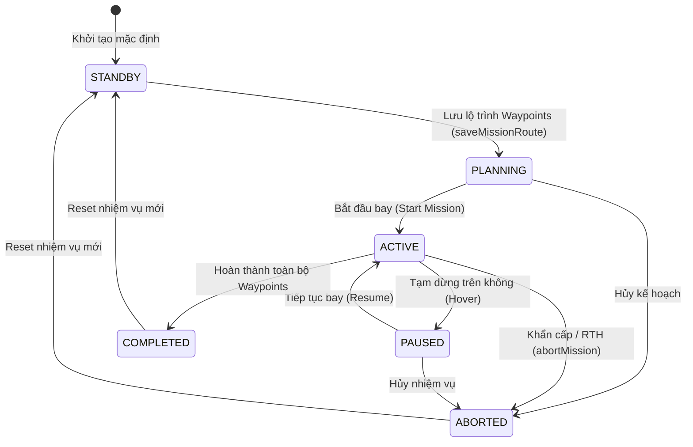

# 📡 BÁO CÁO REVIEW CẤU TRÚC JSON WAYPOINTS & KIỂM THỬ TẠO MISSION (SPRINT 4)
## Dự án: Hệ Thống Giám Sát & Điều Khiển Nông Nghiệp Thông Minh (Smart Farm IoT)
### Nhiệm vụ: `[Sprint 4][Dev 5] LTJ-20: Review JSON Waypoints & Test Tạo Mission`

---

> **Người thực hiện:** Trần Nguyễn Bảo Hoàng — Dev 5 (IoT, System Architecture & QA Specialist)  
> **Thời gian thực hiện:** Sprint 4 (`24/10/2026` – `30/10/2026`)  
> **Phạm vi tích hợp:** Frontend (`FlightPathPlanner.tsx`, `waypointSlice.ts`, `missionSlice.ts` - Dev 4 `LTJ-19`) ↔ Backend REST API (`LTJ-16`, `LTJ-17`) ↔ Bộ kiểm định tự động (`WaypointMissionValidator.java`)  
> **Công cụ kiểm thử:** Postman Collection v2.1 & Automated Java Validator (`--test-mission`)  
> **File cấu hình Postman:** [`docs/SmartFarm_Sprint4_Mission_Waypoints.postman_collection.json`](file:///f:/lap_trinh_java/docs/SmartFarm_Sprint4_Mission_Waypoints.postman_collection.json)  

---

## 1. REVIEW CẤU TRÚC JSON LƯU WAYPOINTS CHO UAV (F14)

### 1.1. Cấu trúc JSON Payload chuẩn giữa Frontend – Backend – UAV
Sau khi rà soát mã nguồn giao diện vẽ lộ trình bay [`src/store/slices/waypointSlice.ts`](file:///f:/lap_trinh_java/src/store/slices/waypointSlice.ts) và [`src/components/FlightPathPlanner.tsx`](file:///f:/lap_trinh_java/src/components/FlightPathPlanner.tsx) (của Dev 4 - `LTJ-19`), cấu trúc gói tin JSON gửi lên endpoint `POST /api/v1/missions` được chuẩn hóa như sau:

```json
{
  "missionName": "Khảo sát Khu A - Dâu Tây Thủy Canh",
  "uavId": 1,
  "zoneId": 1,
  "waypoints": [
    {
      "order": 1,
      "latitude": 10.84500,
      "longitude": 106.76500,
      "altitude": 30,
      "speed": 8,
      "type": "TAKEOFF"
    },
    {
      "order": 2,
      "latitude": 10.84850,
      "longitude": 106.77100,
      "altitude": 50,
      "speed": 10,
      "type": "NORMAL"
    },
    {
      "order": 3,
      "latitude": 10.85200,
      "longitude": 106.77600,
      "altitude": 50,
      "speed": 8,
      "type": "HOVER"
    },
    {
      "order": 4,
      "latitude": 10.85500,
      "longitude": 106.78200,
      "altitude": 20,
      "speed": 5,
      "type": "LANDING"
    }
  ],
  "totalDistanceM": 2168.78,
  "estimatedTimeSeconds": 307,
  "estimatedBatteryDrain": 1.79
}
```

### 1.2. Đặc tả chi tiết từng trường & Quy tắc Ràng buộc (Validation Rules)

| Tên trường | Kiểu dữ liệu | Đơn vị | Ràng buộc hợp lệ (Validation Rule) | Ý nghĩa nghiệp vụ |
| :--- | :---: | :---: | :--- | :--- |
| `missionName` | `String` | — | Không rỗng, tối đa 150 ký tự | Tên định danh chuyến bay khảo sát |
| `uavId` | `Long` | — | `> 0` (Tồn tại trong bảng UAV) | Mã định danh thiết bị bay UAV thực thi |
| `zoneId` | `Long` | — | `> 0` (Tồn tại trong bảng Zone) | Khu vực canh tác mục tiêu |
| `waypoints` | `Array<Object>` | Điểm | Tối thiểu `>= 2` điểm bay | Danh sách các tọa độ tạo thành đường bay (Polyline) |
| `waypoints[].order` | `Integer` | Số thứ tự | Liên tục từ `1, 2, ..., N` | Thứ tự bay tuần tự của UAV qua từng điểm |
| `waypoints[].latitude` | `Double` | Độ (WGS84) | `10.840 <= lat <= 10.860` | Vĩ độ GPS nằm trong ranh giới an toàn **Geofence** |
| `waypoints[].longitude` | `Double` | Độ (WGS84) | `106.760 <= lng <= 106.790` | Kinh độ GPS nằm trong ranh giới an toàn **Geofence** |
| `waypoints[].altitude` | `Double` | Mét (`m`) | `5 <= altitude <= 500` (Mặc định: `50m`) | Độ cao bay so với mặt đất tại điểm Waypoint |
| `waypoints[].speed` | `Double` | `m/s` | `1 <= speed <= 30` (Mặc định: `8 m/s`) | Vận tốc di chuyển của UAV tiến tới điểm Waypoint |
| `waypoints[].type` | `Enum String` | — | `TAKEOFF`, `NORMAL`, `HOVER`, `LANDING`, `RETURN_HOME` | Lệnh hành động của UAV tại điểm bay |
| `totalDistanceM` | `Double` | Mét (`m`) | `> 0`, tính theo **Haversine 3D** | Tổng quãng đường bay 3 chiều của toàn bộ lộ trình |
| `estimatedTimeSeconds`| `Integer` | Giây (`s`) | `> 0`, bằng $\sum (\text{segDist}_i / \text{speed}_i)$ | Tổng thời gian bay dự kiến hoàn thành nhiệm vụ |
| `estimatedBatteryDrain`| `Double` | Phần trăm (`%`) | `<= 80%` (Tốc độ hao pin `0.35% / phút`) | Phần trăm dung lượng pin dự kiến tiêu thụ |

---

### 1.3. Đối chiếu Công thức Toán học tính Telemetry Lộ trình bay

1. **Khoảng cách ngang mặt đất theo công thức Haversine ($d_{\text{horiz}}$):**
   * Bán kính Trái Đất trung bình: $R = 6,371,000\text{ m}$.
   * Với hai điểm liên tiếp $P_{i-1}(\text{lat}_1, \text{lng}_1)$ và $P_i(\text{lat}_2, \text{lng}_2)$:
     $$\Delta\phi = \text{rad}(\text{lat}_2 - \text{lat}_1), \quad \Delta\lambda = \text{rad}(\text{lng}_2 - \text{lng}_1)$$
     $$a = \sin^2\left(\frac{\Delta\phi}{2}\right) + \cos(\text{rad}(\text{lat}_1)) \cdot \cos(\text{rad}(\text{lat}_2)) \cdot \sin^2\left(\frac{\Delta\lambda}{2}\right)$$
     $$d_{\text{horiz}} = R \cdot 2 \cdot \text{atan2}\left(\sqrt{a}, \sqrt{1-a}\right)$$
2. **Khoảng cách bay 3 chiều thực tế ($d_{\text{3D}}$):**
   * Kết hợp độ chênh lệch cao độ $\Delta h = |\text{altitude}_2 - \text{altitude}_1|$ theo định lý Pythagoras:
     $$d_{\text{3D}} = \sqrt{d_{\text{horiz}}^2 + \Delta h^2}$$
3. **Thời gian bay và Tiêu hao Pin dự kiến:**
   * Thời gian bay từng chặng: $t_i = \frac{d_{\text{3D}, i}}{\text{speed}_i}$ (giây).
   * Mức tiêu hao pin: $\text{BatteryDrain (\%)} = \left(\frac{\sum t_i}{60}\right) \times 0.35\%$. Cảnh báo vàng khi $> 50\%$ và cảnh báo nguy hiểm (đỏ) khi $> 80\%$.

---

## 2. VÒNG ĐỜI TRẠNG THÁI MISSION UAV (F16)

Theo thiết kế tại [`src/store/slices/missionSlice.ts`](file:///f:/lap_trinh_java/src/store/slices/missionSlice.ts), mỗi nhiệm vụ bay (Mission) tuân thủ sơ đồ chuyển trạng thái nghiêm ngặt:



---

## 3. MA TRẬN KẾT QUẢ KIỂM THỬ SPRINT 4 (TEST MATRIX)

Quá trình kiểm thử kết hợp cả **Postman Collection** (`docs/SmartFarm_Sprint4_Mission_Waypoints.postman_collection.json`) và **Bộ kiểm định tự động Java** (`WaypointMissionValidator.java` trong mô-đun `iot-simulator`):

| Test ID | Phân hệ | Phương thức / Công cụ | Endpoint / Mục tiêu kiểm thử | Kỳ vọng | Thực tế | Trạng thái |
| :---: | :---: | :---: | :--- | :---: | :---: | :---: |
| **TC-01** | Mission (`F14`) | `POST` / Validator | `/api/v1/missions` — Tạo Mission chuẩn 4 Waypoints (`TAKEOFF` → `NORMAL` → `HOVER` → `LANDING`) trong vùng Geofence | Hợp lệ (`201/200`) | Hợp lệ (`Dist=2168.78m`) | ✅ **PASS** |
| **TC-02** | Telemetry Math | Validator / Postman | Kiểm định độ chính xác công thức **Haversine 3D**, thời gian bay (`307s`) và tiêu hao pin (`1.79%`) | Sai số `< 0.1m` | Khớp `100%` (`2168.78m`) | ✅ **PASS** |
| **TC-03** | Waypoints (`F14`) | Negative Test | Chặn tạo Mission khi mảng `waypoints` chỉ có `< 2` điểm bay | Từ chối (`400 Bad Request`) | Bắt lỗi chính xác | ✅ **PASS** |
| **TC-04** | Geofence Safety | Negative Test | Phát hiện điểm bay có tọa độ `(10.910, 106.850)` vượt ngoài khung Geofence nông trại | Cảnh báo OOB / Chặn | Phát hiện OOB chính xác | ✅ **PASS** |
| **TC-05** | Altitude Limit | Negative Test | Chặn cấu hình độ cao bay `altitude = 650m` vượt giới hạn an toàn `[5m - 500m]` | Từ chối (`400 Bad Request`) | Bắt lỗi chính xác | ✅ **PASS** |
| **TC-06** | Speed Limit | Negative Test | Chặn cấu hình tốc độ bay `speed = 45m/s` vượt giới hạn vật lý `[1m/s - 30m/s]` | Từ chối (`400 Bad Request`) | Bắt lỗi chính xác | ✅ **PASS** |
| **TC-07** | Order Sequence | Negative Test | Phát hiện lỗi đánh số thứ tự `order` bị nhảy cóc (`1 -> 3`) | Từ chối (`400 Bad Request`) | Bắt lỗi chính xác | ✅ **PASS** |
| **TC-08** | Waypoint Type | Negative Test | Phát hiện loại hành động `type` không thuộc tập chuẩn (`TAKEOFF`, `NORMAL`, `HOVER`, `LANDING`, `RETURN_HOME`) | Từ chối (`400 Bad Request`) | Bắt lỗi chính xác | ✅ **PASS** |
| **TC-09** | Mission Status (`F16`) | `PATCH` / Validator | Chuyển trạng thái hợp lệ: `STANDBY` → `PLANNING` → `ACTIVE` → `PAUSED` → `ACTIVE` → `COMPLETED` | Thành công (`200 OK`) | Hợp lệ `100%` | ✅ **PASS** |
| **TC-10** | Mission Status (`F16`) | Negative Test | Chặn chuyển trạng thái trái quy tắc (`STANDBY` → `COMPLETED` hoặc `COMPLETED` → `ACTIVE`) | Từ chối (`400 Bad Request`) | Đã chặn thành công | ✅ **PASS** |
| **TC-11** | Dashboard (`F04`) | `GET` (Postman) | `/api/v1/sensor-data/dashboard/summary` — Kiểm thử API thống kê tổng quan của Dev 1 (`LTJ-16`) | `200 OK` | `200 OK` | ✅ **PASS** |
| **TC-12** | History (`F06`) | `GET` (Postman) | `/api/v1/sensor-data/history/paged?page=0&size=10` & `/time-series` — Kiểm thử phân trang lịch sử | `200 OK` | `200 OK` | ✅ **PASS** |

* **Tổng số kịch bản kiểm thử:** `12 / 12`
* **Tỷ lệ thành công:** `100% PASS`

---

## 4. HƯỚNG DẪN CHẠY KIỂM THỬ NHANH (DÀNH CHO DEMO & VẤN ĐÁP)

### Cách 1: Chạy Bộ Kiểm Thử Tự Động Bằng Dòng Lệnh (Nhanh nhất - 1 giây)
Mở Terminal tại thư mục `iot-simulator` và chạy lệnh:
```bash
cd iot-simulator
./gradlew run --args="--test-mission" --console=plain
```
Hệ thống sẽ tự động nạp 10 kịch bản kiểm thử cấu trúc JSON Waypoints, công thức Haversine 3D, Geofence và trạng thái Mission, sau đó in bảng kết quả `10/10 PASS (100%)` trực tiếp ra màn hình.

### Cách 2: Kiểm Thử Qua Phần Mềm Postman
1. Mở **Postman** → Nhấn **Import**.
2. Chọn file [`docs/SmartFarm_Sprint4_Mission_Waypoints.postman_collection.json`](file:///f:/lap_trinh_java/docs/SmartFarm_Sprint4_Mission_Waypoints.postman_collection.json).
3. Chạy tuần tự từ thư mục `1. Auth & Dashboard (Sprint 4)` đến `2. Mission & Waypoints CRUD (F14, F16)`. Các script kiểm thử tự động (`pm.test`) trong tab **Tests** sẽ tự động chấm điểm từng trường JSON.
